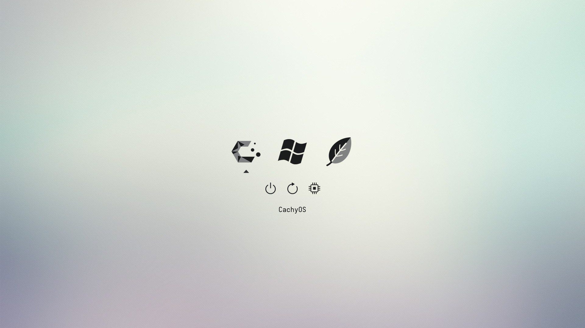
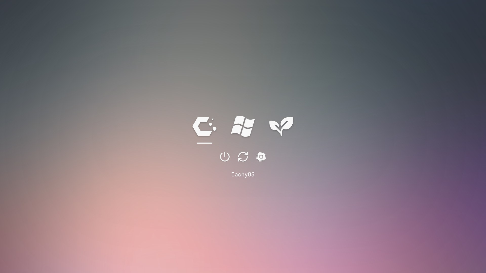
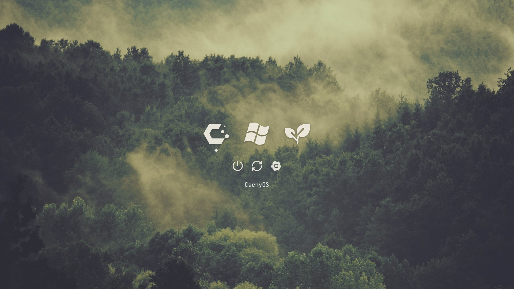
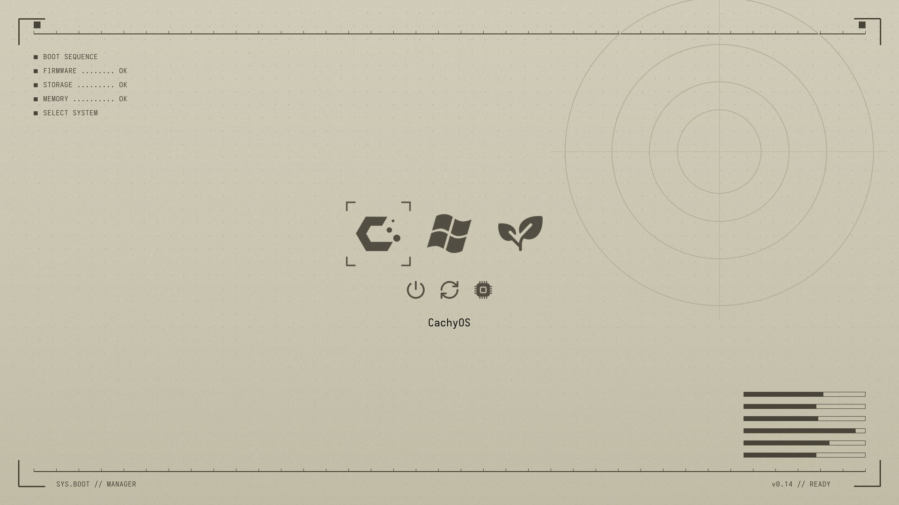

# refind

The rEFInd boot menu for **magikarp**, plus **rEFInd Manager**, a point-and-click
configurator for it: six themes, a background library, theme rotation on every
boot, an icon lab, and a clean three-OS menu (CachyOS → Limine, Windows, Linux Mint).

| minimal | ambience | sublime |
|---|---|---|
|  |  |  |

| synthwave | automata | magikarp |
|---|---|---|
|  |  |  |

minimal, ambience and sublime are our takes on
[rEFInd-minimal](https://github.com/evanpurkhiser/rEFInd-minimal) (Evan Purkhiser, MIT),
[refind-ambience](https://github.com/lukechilds/refind-ambience) (Luke Childs, MIT) and
[refind-sublime](https://github.com/senpaiSubby/refind-sublime) (senpaiSubby); originals in
`upstream/`. synthwave, automata and magikarp (fan art of the machine's
namesake) are generated by `src/tools/gen_backgrounds.py`.

## Use it

1. On magikarp, double-click **rEFInd Manager.desktop** in this folder (or find
   *rEFInd Manager* in the applications menu). The first time, it asks for your
   password once to install the part that writes the boot partition.
2. It syncs with GitHub, starts the server and opens **http://magikarp/refind/** (the magikarp home page
   passes that path through to the manager; `http://magikarp:8765/` works too).
   The same address works from any of your devices on Tailscale.
3. Change things, click **Save & apply**. It builds, commits, pushes and
   updates the boot menu. You'll see it on the next boot.

### Browsers with DNS-over-HTTPS

Browsers that send DNS to Quad9/Cloudflare themselves can't see Tailscale
names, so `http://magikarp/refind/` fails in them until they let the Mac answer for
those names:

- **Zen / Firefox:** Settings → Privacy & Security → DNS over HTTPS →
  *Manage Exceptions…* → add `magikarp` and `ts.net`. Everything else stays on DoH.
- **Helium / Chrome:** there's no exception list. Set *Use secure DNS* to the
  OS default, and keep DNS encrypted by moving it into Tailscale instead: in
  the Tailscale admin console's DNS page, add Quad9 (or Cloudflare) as a global
  nameserver and turn on *Override DNS servers*. Tailscale talks to those over
  DNS-over-HTTPS itself, and tailnet names then resolve everywhere.

Hover an icon or background you'll never use and click ✕ to delete it for good:
it's removed from the repo, listed in `src/removed.json` so it's never offered
again, and committed and pushed. Whatever is selected or saved can't be deleted.

In the page: arrow keys and Enter drive the simulated menu, 1–6 preview a theme,
R simulates a reboot (with your rotation setting), H hides the settings panel.

## What the one-time setup grants

`scripts/install-system.sh` installs a root-owned service,
`refind-esp-sync.service`, that copies the built config from this repo onto
`/boot/EFI/refind`, plus a polkit rule that lets your user start **that one
service** without a password. The service only copies config text and PNGs,
checks every boot entry exists, refuses symlinks, and never runs code from the
repo. Remove it all with `sudo scripts/install-system.sh --uninstall`.

## If something goes wrong

- Undo the boot menu: `sudo cp /boot/EFI/refind/refind.conf.pre-repo /boot/EFI/refind/refind.conf`.
- If rEFInd won't come up, pick **Limine** from the firmware boot menu to reach CachyOS.
- Terminal route for deploying: `sudo scripts/deploy.sh --dry-run`, then `sudo scripts/deploy.sh`.
- Server logs: `journalctl --user -u refind-manager`. Last deploy log: `/var/lib/refind-manager/last-sync.log`.

See [AGENTS.md](AGENTS.md) for the layout and rules, and
[docs/boot-entries.md](docs/boot-entries.md) for what this machine can boot.
